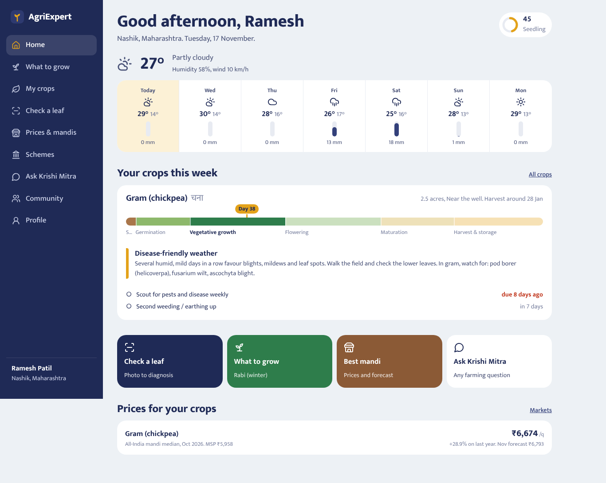
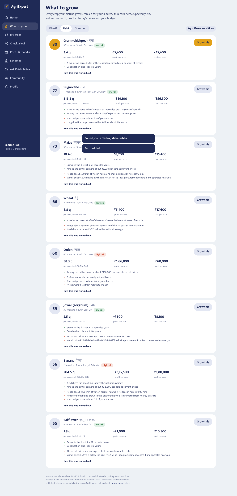
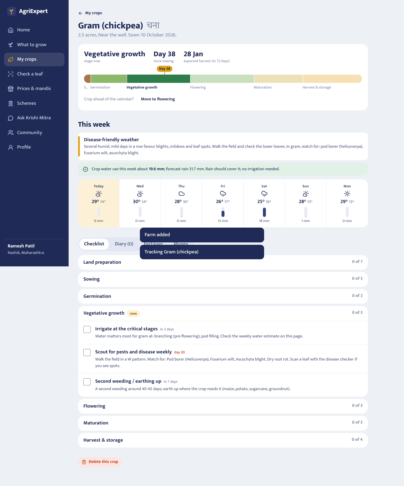
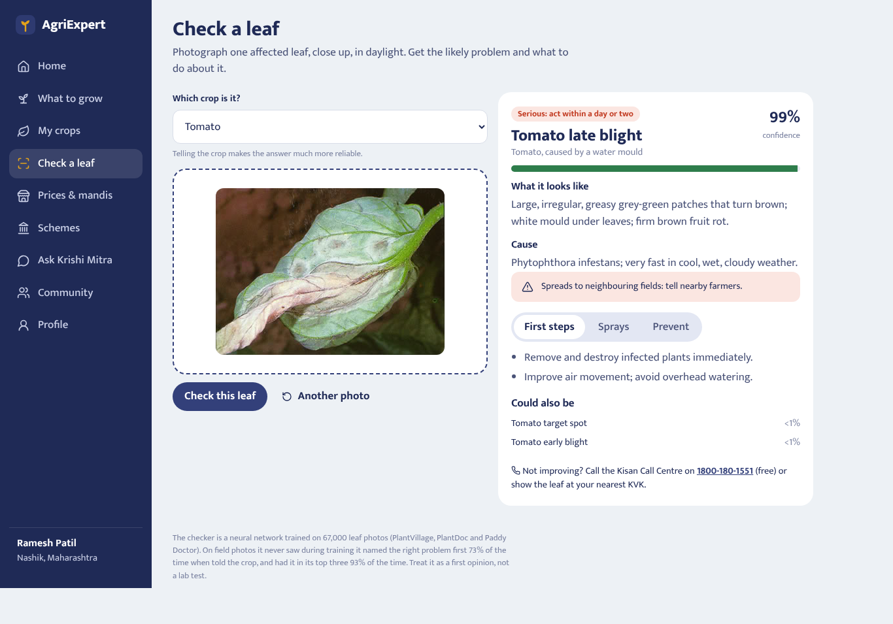
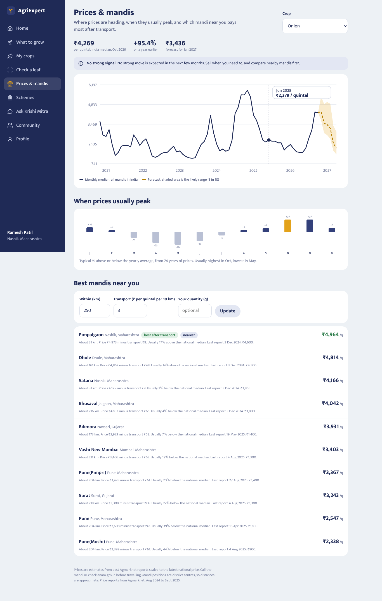
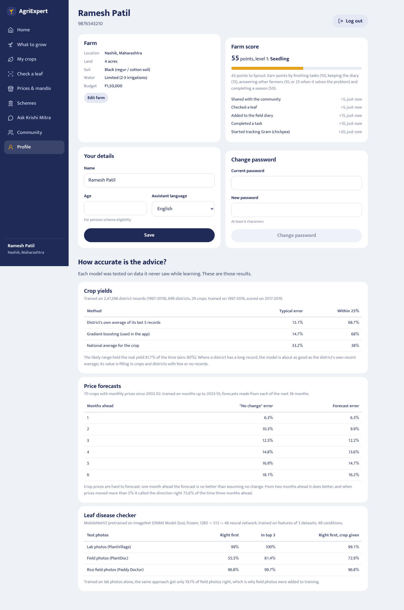
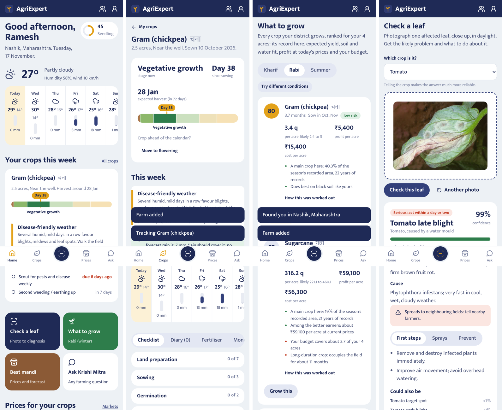

# AgriExpert

A farming companion for Indian smallholders. It covers the whole season: what to grow on
your land, what to do at each stage, weather warnings, the likely problem from a photo of a
sick leaf, schemes you qualify for, and which mandi pays most after transport. Built from
the AZT Coders Agri-Tech Hackathon 2025 project.

Flask API + React (Vite) frontend. Data is kept in MongoDB, or in a local file if you don't
have MongoDB installed.



| What to grow | A crop's season | Leaf check |
|---|---|---|
|  |  |  |

| Prices and mandis | Accuracy report | Phone |
|---|---|---|
|  |  |  |

*The screenshots used a sample weather forecast because the machine they were taken on
could not reach the weather service. On your computer the forecast is live.*

## Run it

You need Python 3.10+ and Node 18+.

```
git clone https://github.com/Mayuresh1134/AgriExpert.git
cd AgriExpert
```

**Backend** (first terminal)

```
cd backend
python -m venv .venv
.venv\Scripts\activate            # Windows.   macOS/Linux: source .venv/bin/activate
pip install -r requirements.txt
python app.py
```

**Frontend** (second terminal)

```
cd frontend
npm install
npm run dev
```

Open http://localhost:5173 and create an account.

**As one process:** run `npm run build` in `frontend`, then `python app.py` in `backend`
serves everything on http://localhost:5050.

No settings are needed for a first run. To change any, copy `backend/.env.example` to
`backend/.env`:

| Setting | What it does |
|---|---|
| `AGRI_DB` | `local` (default) keeps data in `backend/app_data/local_db.json`. `mongo` uses `MONGO_URI`. |
| `GEMINI_API_KEY` | Optional. Turns on open-ended answers from Gemini, in the farmer's language (Hindi, Marathi, Tamil and 6 more). Without it the built-in assistant answers common questions in English. |
| `DATA_GOV_API_KEY` | Optional. Pulls today's mandi prices from data.gov.in. Without it, mandi prices are estimates (see below). |
| `WEATHER_MODE` | `live` (default) uses Open-Meteo, which is free and needs no key. `offline` shows the district's normal rainfall instead. |
| `JWT_SECRET` | Signs login tokens. If empty, one is generated into `app_data/` on first start. |

## What's in it

The screens follow the flow in the hackathon abstract.

| Screen | What it does |
|---|---|
| Farm setup | Three steps: location (GPS, village search, or state and district), land and soil (with Soil Health Card results if you have them), then water, budget and experience. |
| What to grow | Ranks every crop your district grows for the chosen season on six things: its record in the district, expected yield, soil fit, water fit, profit at current prices (per month in the field), and budget. Each crop shows its reasons and cautions, and "How this was worked out" shows every number. "Try different conditions" re-ranks for a different irrigation, area or budget without changing your profile. |
| My crops | Tracks each crop from land preparation to sale. The season ribbon shows the stage and today's position. Every stage has a checklist with real amounts (seed, bags of urea/DAP/MOP for your area), plus a field diary of irrigation, sprays, costs, harvest and sales that adds up to your profit. |
| This week | Weather alerts for the crop's current stage (heavy rain before harvest, frost on sensitive crops, heat at flowering, disease-friendly humid spells, wind before spraying), and how much irrigation the crop needs after forecast rain. |
| Check a leaf | Photo to likely condition, confidence, two alternatives, symptoms, cause, first steps, sprays with doses, and prevention. It warns when unsure. |
| Prices & mandis | Six years of monthly prices, a 6-month forecast with its likely range, the MSP, which months prices usually peak, a hold-or-sell note, and nearby mandis ranked by price minus transport. |
| Schemes | Eleven central schemes (PM-KISAN, PMFBY, KCC, Soil Health Card, PM-KMY, drip and solar subsidies and more), each marked as fitting your farm or not, with documents and how to apply. |
| Ask Krishi Mitra | Chat that knows your farm, crops, stage, weather and prices. |
| Community | Questions and tips filtered by district, state or crop; upvotes; the asker marks the answer that solved it. |
| Farm score | Points for finishing tasks, keeping the diary, helping others and completing a season, in five levels. |

## The models

Each model was tested on data it never saw while learning. The app shows these results on
the Profile page.

### Crop yields

**Data:** district-wise, season-wise area and production for 1997-2020 from the Ministry of
Agriculture (data.gov.in). 247,398 records after cleaning, 699 districts, 29 crops, matched
to today's district map. IMD rainfall normals per district.

**Model:** gradient boosting on the district's past yields, its state and national averages,
location, rainfall by season, and how much area the crop takes in the district.

**Test:** trained on 1997-2016, scored on 2017-2019.

| Method | Typical error | Within 25% |
|---|---|---|
| National average for the crop | 33.2% | 38.0% |
| District's own average of its last 5 records | 15.1% | 68.7% |
| **Gradient boosting (used in the app)** | **14.7%** | **68.0%** |

The likely range shown for each crop held the real yield 81.7% of the time (target 80%).
Where a district has a long record, the model is only about as good as that district's
own recent average. Its value is covering crops and districts with few or no records, and
giving an honest range.

### Price forecasts

**Data:** India-wide median mandi price for every month since 2002, for 166 commodities
(Agmarknet via data.gov.in). 70 have enough history for a forecast.

**Test:** trained on months up to October 2023, then forecast from each of the next 36
months, as it would be used.

| Months ahead | "No change" error | Forecast error |
|---|---|---|
| 1 | 6.3% | 6.3% |
| 3 | 12.5% | 12.2% |
| 6 | 18.1% | 16.2% |

One month ahead the forecast is no better than assuming the price stays put. Further
ahead it does better, and when prices moved more than 5% it called the direction right
about 75% of the time. The forecast range is wide, and the app says so.

### Leaf disease checker

**Data:** 67,290 photos. PlantVillage has 54,305 lab photos (14 crops, 38 classes),
PlantDoc has 2,578 photos taken in real fields, and Paddy Doctor has 10,407 rice field
photos from Tamil Nadu. There are 48 conditions in all.

**Model:** MobileNetV2 (pretrained on ImageNet) turns each photo into 1,280 numbers, and a
small neural network trained on them names the condition. It runs on the CPU in about a
tenth of a second, with no deep-learning library needed in the app.

| Test photos | Right first | In top 3 | Right first, crop given |
|---|---|---|---|
| Lab photos (PlantVillage) | 99.0% | 100% | 99.1% |
| Field photos (PlantDoc) | 55.5% | 81.4% | 72.9% |
| Rice field photos (Paddy Doctor) | 96.8% | 99.7% | 96.8% |

A model trained on lab photos alone, as most tutorials do, got only 19.1% of field photos
right. That is why field photos were added to training, and why the scan screen asks which
crop it is. Field photos remain the weak spot: the PlantDoc test set has only 236 images,
and a few classes (tomato mosaic virus, bacterial spot) are often missed.

### Mandi prices near you

Built from 13,041 real Agmarknet price reports from about 1,150 mandis, downloaded on nine
days between August 2024 and September 2025. For each mandi and crop, the app learns how
the mandi usually compares with the national median (for example "usually 17% above"), then
applies that to the latest national price and subtracts transport at a rate you can change.
These are estimates. Set `DATA_GOV_API_KEY` to use today's reports instead. Mandi positions
are district centres, so distances are approximate.

### Other figures in the app

- **MSP:** Kharif Marketing Season 2026-27 and Rabi Marketing Season 2027-28, as announced by the
  Cabinet. Sugarcane uses the 2026-27 FRP.
- **Costs:** CACP cost of production (A2+FL) where published. For vegetables, spices, fruit
  and fibre crops without a CACP figure, `crops_kb.py` holds a rough per-acre figure. Those
  are estimates to replace with local figures.
- **Agronomy:** seed rates, spacing, NPK doses, water needs, stage durations and disease advice
  in `agri/crops_kb.py` and `agri/diseases_kb.py` follow general Indian package-of-practice
  recommendations. A KVK's local advice should take priority.
- **Banana:** mandi prices are mostly for ripened fruit at city markets, so profit assumes the
  grower gets half of that.

## Retrain the models

```
cd backend
pip install -r requirements-train.txt
python -m ml.prepare_geo  path/to/india-maps-data         # district outlines + rainfall normals
python -m ml.train_yield                                   # about 1 minute
python -m ml.train_prices                                  # under a minute
python -m ml.prepare_mandis
python -m ml.build_backbone path/to/mobilenetv2-12.onnx
python -m ml.extract_features --plantvillage DIR --plantdoc DIR --paddy DIR --out features/   # about 25 minutes
python -m ml.train_disease --features features/            # about 8 minutes
```

The image datasets are large (about 2 GB) and are not included. Each script's docstring
says where to download its inputs. The tables and trained models the app needs are included.

## Tests

```
cd backend
pip install pytest
python -m pytest
```

58 tests cover accounts, the farm profile, recommendations (for example that Ludhiana's rabi
top pick is wheat, and that removing irrigation never raises a crop's water score), fertiliser
maths, stage windows for every crop, task points, the diary and profit, weather parsing and
alerts, the leaf checker on real rice photos, markets, schemes, the assistant, the community
and the local data store. The frontend was clicked through in Chrome on desktop and phone
sizes with no console errors.

## Things to know

- **Rotate the keys from the old repositories.** The original three repos have Gemini API keys,
  a weather API key and a MongoDB Atlas username and password committed in `.env`,
  `geminiService.js`, `weatherService.js` and both `app.py` files. Revoke the keys and change
  the database password; they stay in git history even if the files are deleted. This
  version reads every secret from `.env`, which git ignores.
- **Screens are in English.** Crop names also show in Hindi, and with a Gemini key the assistant
  answers in nine Indian languages. A translated interface is the most useful next step.
- **Not included:** password reset by SMS or email, admin moderation for the community, offline
  use without internet, push notifications.
- **Gemini and live mandi prices were not tested** because no keys were available. Both fall
  back to the built-in behaviour if a call fails.
- **Data licences:** the crop and price statistics are under India's Government Open Data
  Licence. The image datasets were used only to train the model weights, and none of their
  images are shipped. Check each dataset's terms (PlantVillage, PlantDoc, Paddy Doctor, the
  district boundary files) before commercial use. MobileNetV2 (ONNX Model Zoo) is Apache-2.0
  and the Mukta font is SIL OFL.

## What changed from the hackathon version

| | Before | Now |
|---|---|---|
| Structure | Three separate repos and servers (Express stages API, Flask chatbot, Flask disease app) | One API, one frontend, one login |
| "AI" | Every answer was a Gemini prompt; nothing was trained | Yield, price and disease models trained on real Indian data and tested on held-out data; Gemini is optional |
| Disease check | Four separate Gemini calls per photo, returning free text | A local model: under a second, works without a key, gives confidence and alternatives |
| Crop recommendation | Gemini guessed crops from the farm form | Ranked from 23 years of district records, current prices, costs, soil, water and budget, with the working shown |
| Lifecycle | Seven backend endpoints with no screens | Stage tracking with the season ribbon, checklists with real amounts, field diary and profit |
| Weather | A key committed to the repo; data fetched but not acted on | Free forecast without a key, turned into stage-specific alerts and a water-need estimate |
| Markets, schemes, community | Not built | Built |
| Secrets | API keys and database password committed | Read from `.env`, which git ignores |
| Frontend | Two single-page Create React App demos | One responsive React app for phone and desktop |

## Project layout

```
backend/
  app.py                 start the server
  agri/
    routes.py            every API route
    recommend.py         crop ranking and fertiliser plans
    lifecycle.py         stages, checklists, diary summary
    weather.py           forecast, alerts, water need
    disease.py vision.py leaf model (ONNX backbone + numpy head)
    markets.py           price outlook and best mandi
    schemes.py assistant.py
    crops_kb.py          30 crops: agronomy, MSP, costs
    diseases_kb.py       48 conditions: symptoms and treatment
    geo.py db.py core.py config.py
    data/                districts, yield table, prices, mandis (built by ml/)
  ml/                    data preparation and training scripts
  models/                trained models and their test results
  data/raw/              source tables
  tests/
frontend/src/
  pages/                 one file per screen
  components/            season ribbon, weather strip, charts, form controls
  styles/app.css         the whole look
```
